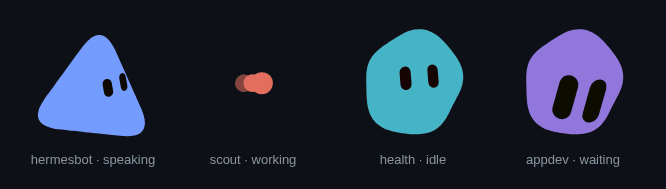
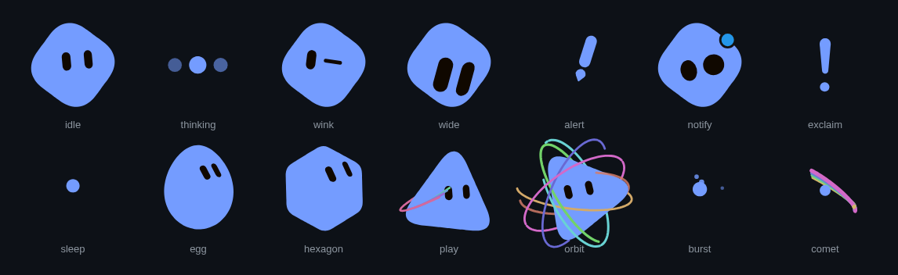
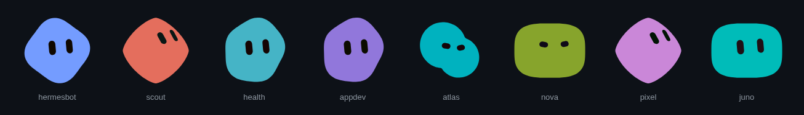
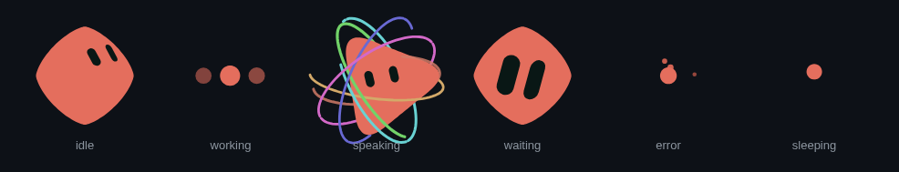

# bloub-swift

A living bot avatar for SwiftUI (and TypeScript): one filled shape that morphs through fourteen
measured states, with two capsule eyes painted on a sphere. Give it an id and it gets its own body,
colour and resting face, the same on every device.



It is a port of [bloub](https://github.com/jeremy-prt/bloub) by Jérémy Perret, the SVG recreation of
the x.ai bot avatar measured frame by frame off the reference video. This repository keeps that
engine, replaces its look with our own and adds a Swift package held to the same numbers as the
TypeScript engine.

- **SwiftUI view:** `BloubView(profile:status:size:)`, drawn with `Canvas` at display rate.
- **Pure engine:** `BotEngine.sample(t)` depends only on time. Pausing, slow motion and jumping to
  any date give exactly the same frame.
- **Foundation-only core:** the `Bloub` module builds and tests on Linux too.
- **One contract, two languages:** Swift reads the golden frames the TypeScript engine writes.

## The fourteen states



Each state is a measured sequence, not a tween between key poses. `thinking` draws three typing
dots, `sleep` is a small bouncing dot, `burst` collapses into particles and `orbit` is a body inside
rings.

## One id, one look



The id is hashed (FNV-1a, 32 bit) into a body (one of eight silhouettes), a palette (generated from
an OKLCH hue) and a resting mood. No image is stored: the same id draws the same avatar on a phone,
a widget and a web page.

## Status to state



Apps think in statuses, not animation states. `BotStatus` maps each status to a state, a loop rule
and a frame rate:

| Status | State | Loops | Frame rate |
|---|---|---|---|
| `idle` | `idle` (gaze drift and blinks) | yes | 4 fps |
| `working` | `thinking` | yes | 30 fps |
| `speaking` | `orbit` | yes | 30 fps |
| `waiting` | `wide` | no | 12 fps |
| `error` | `burst`, back to idle after 10 s | no | 30 fps |
| `sleeping` | `sleep` | yes | 4 fps |

## Install

Swift Package Manager, iOS 26 and macOS 26:

```swift
.package(url: "https://github.com/UltraInstinct0x/bloub-swift", branch: "main")
```

```swift
.product(name: "Bloub", package: "bloub-swift"),    // engine and identity, Foundation only
.product(name: "BloubUI", package: "bloub-swift"),  // SwiftUI views, Apple platforms
```

The package manifest lives in `swift/`.

## Use

```swift
import BloubUI

// Animated. Pauses while the scene is not active; Reduce Motion draws one still pose.
BloubView(profile: "my-bot", status: .speaking, size: 64)

// One still frame, for widgets, Live Activities and snapshots.
BloubStill(profile: "my-bot", status: .idle, size: 34)

// A PNG of any avatar, for share sheets or notifications.
let png = bloubPNG(profile: "my-bot", status: .waiting, side: 160)
```

Without SwiftUI, sample the engine and draw the frame yourself:

```swift
import Bloub

let engine = engineForAvatar("my-bot", status: "speaking")
let frame = engine.sample(1.25)   // seconds; the same t always gives the same frame
let look = avatarFor("my-bot")    // body shape, palette, resting mood
```

## Test

```sh
cd swift && swift test       # engine contract: golden frames, identity, eye fit (Linux and macOS)
cd ts && npm ci && npm test  # the TypeScript engine and the golden generator
```

The identity seed is `fnv1a32("hermes-avatar/v1:" + id)`. The prefix keeps its original name on
purpose: changing it would give every existing avatar a different look.

The images in `docs/images` are rendered from the TypeScript engine, the same numbers the Swift port
is tested against.

## Layout

```
ts/            @hermes/avatar — ESM, TypeScript strict, vitest
  src/
    engine.ts       BotEngine: sample(t) -> BotFrame. The whole public surface.
    states.ts       the 14 measured states (plus `swirl`, an interface transition)
    cycles.ts       montage: blocks of states, durations, storage read-back
    shape.ts        radial-profile geometry: morph, path, ray casting
    face.ts         the eye sphere, gaze drift, blink schedule
    expressions.ts  16 expressions (eye shape, spacing, per-eye tilt)
    eyefit.ts       where to place the face on a non-circular body
    decor.ts        rings, particles, comet ribbons, notification pastille
    profiles.ts     radial profiles measured off bloub's reference footage
    repere.ts       the viewBox frame of reference
    skins.ts        OUR eight body silhouettes
    identity.ts     seed -> shape + palette + resting mood
    status.ts       bot status -> engine state
  scripts/
    gen-golden.ts     writes golden/*.json
    golden-cases.ts   the case list and the rounding, shared with the test
  test/            vitest, including the golden verifier
golden/          the cross-language contract: identity.json, frames.json
```

## Running it

```bash
cd ts
npm ci
npm run typecheck
npm test
npm run gen:golden     # regenerates ../golden; commit the diff if it is intended
```

`npm test` includes the golden verifier, so it fails if the engine stopped drawing what
`golden/` says it draws.

## The identity look

A bot's look is a pure function of its profile id (the profile part of the bot key —
`splitBotKey(key).id` — never the display name, so renaming a bot does not restyle it):

```
seed = fnv1a32("hermes-avatar/v1:" + profileId)
```

`mulberry32(seed)` is then drawn in one fixed order — twelve draws, in `DRAW_ORDER` — giving:

1. **shape**, one of our eight silhouettes (`orb`, `lozenge`, `wedge`, `trefoil`, `quatrefoil`,
   `bean`, `blob`, `pentagon`);
2. **palette**: body, shadow and eye. The body hue comes from the seed over the full wheel;
   lightness and chroma stay in fixed ranges (`PALETTE_RANGES`) so every bot stays readable —
   the eye is always far darker than the body. Colours are built in OKLCH and rasterised to
   hex, out-of-gamut by reducing chroma rather than clamping channels;
3. **resting mood**, one of three (`calm` → `neutre`, `bright` → `attentif`, `amused` →
   `heureux`), plus the transition odds between the three for the next rest window. The engine
   has no clock: the host re-draws at most every `REST_SETTLE_SECONDS` (45 s).

The draw order is a contract. Adding a parameter means **appending** a draw; inserting one
restyles every bot in the fleet at once and breaks `golden/identity.json`.

A user-chosen image avatar still wins over the live one, as in the design note.

## Status mapping

| bot status | engine state | why |
|---|---|---|
| `idle` | `idle` | the rest pose: sparse gaze drift and blinks |
| `working` | `thinking` | periodic three-dot pulse, seamless as a loop |
| `waiting` | `wide` | the attention pose, and it keeps the bot's own body |
| `error` | `burst` | the only "something broke" state; recovers after `revert` (10 s → `idle`) |
| `speaking` | `orbit` | the only remaining continuous loop that keeps the body and reads live |
| `sleeping` | `sleep` | the slowly bouncing dot |

`waiting` is deliberately **not** `alert`: `alert` is the most literal attention-grabber, but it
replaces the silhouette with the "!" glyph, and a bot waiting for an answer has to stay
recognisable as itself. The same rule rejects `exclaim`, and `notify` (its blue pastille claims
"you have a notification", which is a different thing from "this bot needs your answer").

`engineForAvatar(profileId, status)` is the whole integration surface: it builds the engine with
the bot's shape, its resting expression and the right state.

## The golden set

`golden/` is the cross-language contract. TypeScript writes it; the Swift port reads it and must
reproduce the same numbers.

- `golden/identity.json` — eight profile ids (including `hermesbot`, `appdev`, `health`,
  `scout`) with the shape, palette and resting mood each derives to.
- `golden/frames.json` — twelve cases, 32 frames: identity, state, setup operations and dates,
  each with the full `sample(t)` output. Every number is rounded to 1e-6; paths and eye matrices
  are strings already rounded to two decimals by the engine.

The generator and the verifier share `ts/scripts/golden-cases.ts` — the case list, the engine
construction and the rounding — so a golden mismatch is a difference in the engine and not in
the harness. CI regenerates the set and fails if the committed files differ.

## Design rights

The **engine** is ported from [bloub](https://github.com/jeremy-prt/bloub) (MIT, Jérémy Perret);
see `NOTICE`. The **look is ours**: the eight silhouettes in `skins.ts` are built here, the
palette is generated from each bot's seed, and the resting moods are a subset of the expression
catalogue. Nothing in this repository reproduces the x.ai bot's avatar, palette or default
shape — only the machinery bloub measured and released.

## Licence

MIT. See `LICENSE` (bloub's copyright line is kept above ours) and `NOTICE`.
